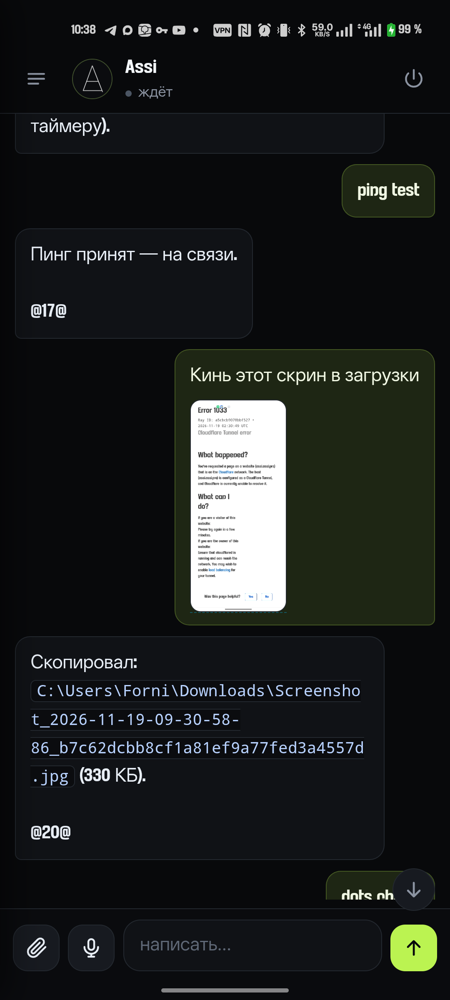

# Assi App

Android-приложение для [Assi Bridge](https://github.com/F0RN1/assi-bridge): телефон как пульт к компьютеру с OpenCode.

<p align="center"></p>

## Что внутри

Один APK, без сторонних приложений и без TWA:

- **WebView-оболочка** над веб-чатом моста — обновления интерфейса приезжают с сервера, APK переустанавливать не нужно.
- **Экран настройки сервера** — при первом запуске вводится адрес (свой домен, локальный IP или туннель) и токен.
- **Wake-on-LAN нативно** — Java шлёт magic-пакет, поэтому «Разбудить ноут» работает, даже когда сервер спит и страница недоступна.
- **Сторож связи** — каждые 30 секунд запрос `GET /api/ping`; два промаха подряд или страница Cloudflare 1033 → экран «Сервер не отвечает» с кнопками «Разбудить ноут» и «Повторить». Когда сервер оживает, приложение само перезагружает чат.
- **Файлы и фото** — нативный выбор файлов, камера и галерея через `WebChromeClient`.
- **Файлы с ПК** — кнопка-проводник в шапке: диски и папки компьютера, скачивание через `DownloadManager` прямо в «Загрузки» телефона.
- **Микрофон** — запись голоса прямо в чат (уходит на расшифровку мосту).
- **Экран питания** — Разбудить / Сон / Заблокировать / Перезагрузить / Выключить / Сменить сервер.

## Установка

Готовый APK отдаёт сам мост: `https://<ваш-домен>/apk` или кнопка «скачать APK» на хабе `http://127.0.0.1:8787/local`.

Либо собрать самому:

```bash
export JAVA_HOME=/path/to/jdk
export ANDROID_HOME=/path/to/android-sdk
export ASSI_STORE_PASS=...   # пароль keystore
export ASSI_KEY_PASS=...
./gradlew assembleRelease
adb install -r app/build/outputs/apk/release/app-release.apk
```

Первый экран: адрес сервера (`https://assi.example.com`), затем токен — оба показывает `/local` на компьютере.

## Структура

```
app/src/main/java/ru/f0rn1/assibridge/MainActivity.java   WebView, настройка, WOL, сторож связи
app/src/main/res/                                        тема, иконки
build.gradle, settings.gradle, gradle.properties         сборка (applicationId ru.f0rn1.assibridge)
```

Серверная часть: [F0RN1/assi-bridge](https://github.com/F0RN1/assi-bridge).

## Лицензия

MIT
